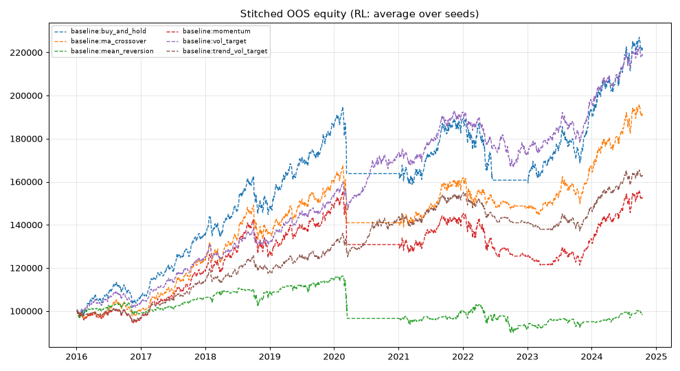

# RESULTS - quant-rl-bot walk-forward research

> Paper-trading research only. Validation (walk-forward out-of-sample) results; the locked test set was **not** used here. final_test.py has not been run yet.

- Generated: 2026-10-18 01:29  
- Data source: `yahoo`  
- Round: 4  
- Variants tried (all rounds, used for Sharpe penalty): **27**  
- Development data ends: 2024-10-15; locked test set: 2024-10-16 -> 2026-10-16  
- Costs: 15 bps per unit traded (commission + slippage)  
- Survival rule: run DEAD if equity falls > 15% below its peak (start 100,000)

## Verdict

Active Sharpe test: **penalized** (see PROPOSALS.md for the proposed alternative; changing it requires the owner's approval).

**NO STRATEGY PASSED.** No strategy met all of: positive OOS return after costs, penalized Sharpe > 1.0, survival >= 80%, Sharpe above buy-and-hold on the same windows, beating its own rule without RL (overlays), and robustness under 2x costs and other seeds. This is a normal, honest outcome.

## Experiments: RL agents and rules (every variant, including failures)

| experiment | algo | status | runs ok | survived | OOS return (mean seeds) | worst seed | Sharpe | penalized Sharpe | DSR prob | Sortino | max DD (stitched) | turnover/yr | Sharpe - B&H | DD / B&H DD | rule-only Sharpe | low-risk match | verdict | would pass PROPOSED bar P1+P2 (NOT active) |
|---|---|---|---|---|---|---|---|---|---|---|---|---|---|---|---|---|---|---|

Columns: *OOS return* = stitched walk-forward validation return after costs, mean over seeds. *Sharpe* = mean over seeds of the stitched OOS Sharpe. *Penalized Sharpe* = Sharpe minus the expected best-of-N Sharpe under no skill (N = variants tried). *DSR prob* = deflated Sharpe probability. *Survived* = walk-forward runs (fold x seed) that never hit the drawdown kill switch. *Sharpe - B&H* = Sharpe minus buy-and-hold's on the same windows. *DD / B&H DD* = stitched max drawdown relative to buy-and-hold's (below 1 = shallower). *Rule-only Sharpe* = the overlay's rule with the agent removed (multiplier fixed at 1); the agent must beat it. *Low-risk match* = Sharpe within 0.1 of B&H with <= 60% of its drawdown (informational). *Would pass PROPOSED bar P1+P2* = same checks but with 'Sharpe > 1 and deflated-Sharpe prob > 0.95' instead of 'penalized Sharpe > 1' (P1), and for rules also passing 2007-2015 (P2); NOT active, see PROPOSALS.md. *algo RULE* = a fixed rule, no learning.

## Baselines (same windows, same costs, same survival rule; fixed textbook parameters)

| experiment | algo | status | runs ok | survived | OOS return (mean seeds) | worst seed | Sharpe | penalized Sharpe | DSR prob | Sortino | max DD (stitched) | turnover/yr | Sharpe - B&H | DD / B&H DD | rule-only Sharpe | low-risk match | verdict | would pass PROPOSED bar P1+P2 (NOT active) |
|---|---|---|---|---|---|---|---|---|---|---|---|---|---|---|---|---|---|---|
| baseline:buy_and_hold | rule | ok | 9/9 | 7/9 (78%) | +120.9% | +120.9% | 1.06 | 0.38 | 0.86 | 1.48 | 18.5% | 1.0 | +0.00 | 1.00 | n/a | no | benchmark | - |
| baseline:ma_crossover | rule | ok | 9/9 | 8/9 (89%) | +90.6% | +90.6% | 0.96 | 0.28 | 0.78 | 1.32 | 17.1% | 1.8 | -0.10 | 0.93 | n/a | no | benchmark | - |
| baseline:mean_reversion | rule | ok | 9/9 | 8/9 (89%) | -1.8% | -1.8% | 0.00 | -0.68 | 0.02 | 0.01 | 22.5% | 13.2 | -1.06 | 1.22 | n/a | no | benchmark | - |
| baseline:momentum | rule | ok | 9/9 | 8/9 (89%) | +51.7% | +51.7% | 0.62 | -0.07 | 0.42 | 0.84 | 22.1% | 6.6 | -0.45 | 1.20 | n/a | no | benchmark | - |
| baseline:vol_target | rule | ok | 9/9 | 9/9 (100%) | +118.4% | +118.4% | 1.46 | 0.78 | 0.99 | 2.13 | 13.3% | 3.0 | +0.40 | 0.72 | n/a | no | benchmark | - |
| baseline:trend_vol_target | rule | ok | 9/9 | 9/9 (100%) | +62.4% | +62.4% | 1.04 | 0.36 | 0.85 | 1.48 | 11.5% | 6.8 | -0.02 | 0.62 | n/a | no | benchmark | - |

## Robustness (top validation candidates)

Not run.

## Why each experiment failed or passed

## Walk-forward folds

| fold | train | validation |
|---|---|---|
| 0 | 2012-01-04 -> 2015-12-28 | 2016-01-04 -> 2017-01-03 |
| 1 | 2012-01-04 -> 2016-12-28 | 2017-01-04 -> 2018-01-03 |
| 2 | 2012-01-04 -> 2017-12-28 | 2018-01-04 -> 2019-01-03 |
| 3 | 2012-01-04 -> 2018-12-28 | 2019-01-04 -> 2020-01-03 |
| 4 | 2012-01-04 -> 2019-12-30 | 2020-01-04 -> 2021-01-03 |
| 5 | 2012-01-04 -> 2020-12-28 | 2021-01-04 -> 2022-01-03 |
| 6 | 2012-01-04 -> 2021-12-28 | 2022-01-04 -> 2023-01-03 |
| 7 | 2012-01-04 -> 2022-12-28 | 2023-01-04 -> 2024-01-03 |
| 8 | 2012-01-04 -> 2023-12-28 | 2024-01-04 -> 2024-10-15 |

## Data quality

| ticker | rows | start | end | years | jumps > 25% (check splits) | lag-1 autocorr of daily returns (dev data) |
|---|---|---|---|---|---|---|
| SPY | 4223 | 2010-01-04 | 2026-10-16 | 16.8 | - | -0.101 |
| QQQ | 4223 | 2010-01-04 | 2026-10-16 | 16.8 | - | -0.088 |
| GLD | 4223 | 2010-01-04 | 2026-10-16 | 16.8 | - | -0.010 |
| TLT | 4223 | 2010-01-04 | 2026-10-16 | 16.8 | - | -0.040 |
| RELIANCE.NS | 4145 | 2010-01-04 | 2026-10-16 | 16.8 | - | -0.007 |
| TCS.NS | 4145 | 2010-01-04 | 2026-10-16 | 16.8 | - | -0.003 |

## Equity curves (out-of-sample, stitched)

## Caveats

- Validation numbers are optimistic once you pick the best of many variants; the penalized Sharpe tries to correct for that but cannot fully.
- Daily close-to-close fills, fixed proportional costs, no taxes, no borrow fees for shorts, no FX (Indian stocks are in INR, returns are currency-neutral here).
- Yahoo adjusted prices can contain errors; see data-quality table.
- Past performance does not predict future results. Paper trading only.

## Round 4 research: diversified allocation rules (pre-registered plan)

- Plan `research/plan_round4.yaml` sha `5e50bb114cdd`; hypotheses registered: 7, exploratory (added/changed after registration): 0  
- **Trials counted for the Sharpe penalty: 34** (27 from rounds 1-3 + 7 round-4)  
- Exploration: ETF universe, one-year windows 2007-01-01 -> 2024-10-15, fresh 100,000 each window, 15 bps costs, 15% kill switch, leverage pays T-bill + 1%, idle cash earns 0  
- Tickers not loaded: none

| strategy | trial | Sharpe | CAGR | vol | max DD (stitched) | worst year | survived | turnover/yr | avg exposure | Sharpe - 60/40 | p (Sharpe <= 60/40) | CAGR at 10% vol | penalized Sharpe | DSR prob | Sharpe 2x costs | min neighbour Sharpe | shifted windows Sharpe | Sharpe if cash earned T-bill (P5) | finalist | verdict | P4 (NOT active) |
|---|---|---|---|---|---|---|---|---|---|---|---|---|---|---|---|---|---|---|---|---|---|
| H0_incumbent_vol_target | registered | 0.64 | +3.5% | 5.5% | 13.6% | -10.3% | 18/18 | 2.7 | 0.81 | +0.04 | 0.432 | +4.2% | 0.14 | 0.72 | 0.57 | 0.63 | 0.63 | 0.68 | no | FAIL | no |
| H1_equal_weight | registered | 0.27 | +1.9% | 7.8% | 31.1% | -15.1% | 14/18 | 1.3 | 1.00 | -0.33 | 0.991 | +1.6% | -0.23 | 0.16 | 0.24 | n/a | 0.49 | 0.27 | no | FAIL | no |
| H2_inverse_vol | registered | 0.68 | +3.9% | 5.9% | 22.2% | -12.9% | 17/18 | 2.0 | 1.00 | +0.08 | 0.334 | +4.8% | 0.18 | 0.77 | 0.63 | 0.62 | 0.73 | 0.68 | yes | FAIL | no |
| H3_trend_following | registered | 0.67 | +2.7% | 4.0% | 9.4% | -3.9% | 18/18 | 2.5 | 0.64 | +0.07 | 0.387 | +3.0% | 0.17 | 0.76 | 0.58 | 0.61 | 0.69 | 0.83 | yes | FAIL | no |
| H4_dual_momentum | registered | 0.45 | +4.2% | 10.2% | 17.1% | -12.8% | 16/18 | 5.3 | 0.93 | -0.15 | 0.754 | +4.1% | -0.05 | 0.41 | 0.37 | 0.34 | 0.41 | 0.47 | no | FAIL | no |
| H5_ensemble | registered | 0.67 | +4.0% | 6.1% | 14.6% | -7.1% | 18/18 | 3.3 | 0.85 | +0.07 | 0.372 | +4.9% | 0.17 | 0.76 | 0.59 | n/a | 0.68 | 0.72 | yes | FAIL | no |
| H6_ensemble_vol_target_10 | registered | 0.43 | +3.6% | 9.1% | 26.2% | -15.6% | 15/18 | 5.4 | 1.40 | -0.17 | 0.852 | +3.7% | -0.07 | 0.39 | 0.35 | 0.44 | 0.50 | 0.43 | no | FAIL | no |
| bench:60_40 | benchmark | 0.60 | +5.0% | 8.7% | 32.7% | -16.3% | 14/18 | 1.2 | 1.00 | n/a | n/a | +5.3% | n/a | n/a | n/a | n/a | n/a | n/a | - | benchmark | - |
| bench:buy_and_hold | benchmark | 0.45 | +5.2% | 13.2% | 45.6% | -16.6% | 11/18 | 1.0 | 1.00 | n/a | n/a | +4.1% | n/a | n/a | n/a | n/a | n/a | n/a | - | benchmark | - |

*CAGR at 10% vol*: what the strategy would have earned run at 10% annual volatility (borrowing at T-bill + 1% if it needs leverage, idle cash at 0). It compares profit at EQUAL risk. *p*: paired block bootstrap probability that the Sharpe advantage over 60/40 is not real (smaller = more convincing).

### Why each hypothesis passed or failed

- **H0_incumbent_vol_target** (registered): FAIL - penalized Sharpe 0.14 (raw 0.64 - haircut 0.50) not > 1.0; not a finalist
- **H1_equal_weight** (registered): FAIL - penalized Sharpe -0.23 (raw 0.27 - haircut 0.50) not > 1.0; survival 14/18 = 78% < 80%; Sharpe 0.27 not above buy-and-hold 0.45; Sharpe 0.27 not above 60/40 0.60; robustness costs_2x failed: Sharpe 0.24 <= 0.5, survival 78%; not a finalist
- **H2_inverse_vol** (registered): FAIL - penalized Sharpe 0.18 (raw 0.68 - haircut 0.50) not > 1.0
- **H3_trend_following** (registered): FAIL - penalized Sharpe 0.17 (raw 0.67 - haircut 0.50) not > 1.0
- **H4_dual_momentum** (registered): FAIL - penalized Sharpe -0.05 (raw 0.45 - haircut 0.50) not > 1.0; Sharpe 0.45 not above 60/40 0.60; robustness costs_2x failed: Sharpe 0.37 <= 0.5; robustness param_neighborhood failed: {'top_frac': 0.5}: Sharpe 0.34 <= 0.5; not a finalist
- **H5_ensemble** (registered): FAIL - penalized Sharpe 0.17 (raw 0.67 - haircut 0.50) not > 1.0
- **H6_ensemble_vol_target_10** (registered): FAIL - penalized Sharpe -0.07 (raw 0.43 - haircut 0.50) not > 1.0; Sharpe 0.43 not above buy-and-hold 0.45; Sharpe 0.43 not above 60/40 0.60; robustness costs_2x failed: Sharpe 0.35 <= 0.5; robustness param_neighborhood failed: {'target': 0.08}: Sharpe 0.47 <= 0.5, {'target': 0.12}: Sharpe 0.44 <= 0.5; not a finalist

### Correlation of daily returns (exploration)

| | H2_inverse_vol | H3_trend_following | H4_dual_momentum | bench:60_40 |
|---|---|---|---|---|
| H2_inverse_vol | 1.00 | 0.68 | 0.53 | 0.73 |
| H3_trend_following | 0.68 | 1.00 | 0.80 | 0.62 |
| H4_dual_momentum | 0.53 | 0.80 | 1.00 | 0.57 |
| bench:60_40 | 0.73 | 0.62 | 0.57 | 1.00 |

### Finalists (pre-registered rule: survival >= 80%, positive return at 2x costs, top 3 by Sharpe)

H2_inverse_vol, H3_trend_following, H5_ensemble

### Confirmation (mutual funds, 1991-2006, never used before)

| strategy | Sharpe | CAGR | max DD | survived | verdict |
|---|---|---|---|---|---|
| H2_inverse_vol | 2.04 | +10.6% | 7.6% | 16/16 | PASS |
| H3_trend_following | 2.00 | +8.7% | 7.6% | 16/16 | PASS |
| H5_ensemble | 1.87 | +11.0% | 9.6% | 16/16 | PASS |
| bench:buy_and_hold | 0.78 | +10.3% | 43.4% | 12/16 | benchmark |
| bench:60_40 | 0.98 | +9.4% | 34.2% | 14/16 | benchmark |

Funds not loaded: none. Data quality:

| fund | rows | start | end | jumps > 25% |
|---|---|---|---|---|
| VFINX | 4792 | 1988-01-04 | 2006-12-29 | - |
| NAESX | 4792 | 1988-01-04 | 2006-12-29 | - |
| VWIGX | 4792 | 1988-01-04 | 2006-12-29 | - |
| VEIEX | 3190 | 1994-05-04 | 2006-12-29 | - |
| VUSTX | 4792 | 1988-01-04 | 2006-12-29 | - |
| VFITX | 3826 | 1991-10-28 | 2006-12-29 | - |
| VWESX | 4792 | 1988-01-04 | 2006-12-29 | - |
| VWEHX | 4792 | 1988-01-04 | 2006-12-29 | - |
| VGPMX | 4792 | 1988-01-04 | 2006-12-29 | - |
| FRESX | 4792 | 1988-01-04 | 2006-12-29 | - |

### Return per one-year window (exploration; DEAD = kill switch)

| window | H0_incumbent_vol_target | H1_equal_weight | H2_inverse_vol | H3_trend_following | H4_dual_momentum | H5_ensemble | H6_ensemble_vol_target_10 | bench:60_40 | bench:buy_and_hold |
|---|---|---|---|---|---|---|---|---|---|
| 2007-01-01 | +7.3% | +10.5% | +9.1% | +5.4% | +16.5% | +10.4% | +12.0% | +7.1% | +5.2% |
| 2008-01-01 | -5.6% | -12.3% DEAD | -12.9% DEAD | +2.6% | +1.3% | -0.4% | -11.0% DEAD | -16.3% DEAD | -15.9% DEAD |
| 2009-01-01 | +7.5% | -14.3% DEAD | +10.6% | +1.2% | +7.2% | +6.4% | +10.4% | -16.0% DEAD | -15.0% DEAD |
| 2010-01-01 | +9.0% | +13.1% | +10.7% | +7.6% | +14.7% | +11.2% | +13.1% | +12.5% | -8.8% DEAD |
| 2011-01-01 | +2.7% | +4.6% | +7.7% | +4.0% | -9.2% DEAD | +0.3% | +3.3% | +14.7% | -11.1% DEAD |
| 2012-01-01 | +6.2% | +9.3% | +6.9% | +5.6% | +8.0% | +6.8% | +10.5% | +10.7% | +14.0% |
| 2013-01-01 | -0.6% | +0.3% | -1.0% | +1.4% | +13.0% | +4.4% | +6.2% | +10.9% | +28.8% |
| 2014-01-01 | +3.7% | +5.2% | +5.3% | +3.4% | +5.7% | +4.9% | +7.8% | +19.5% | +14.4% |
| 2015-01-01 | -5.1% | -4.6% | -3.8% | -1.0% | -1.5% | -2.1% | -3.9% | +0.1% | +1.1% |
| 2016-01-01 | +6.1% | +9.4% | +6.9% | +0.4% | -4.8% | +0.8% | +2.4% | +8.4% | +13.4% |
| 2017-01-01 | +9.2% | +9.8% | +7.2% | +5.6% | +14.5% | +9.1% | +14.5% | +15.7% | +20.6% |
| 2018-01-01 | -4.0% | -5.1% | -2.4% | -3.9% | -2.3% | -2.8% | -8.6% | -3.0% | -7.1% DEAD |
| 2019-01-01 | +12.9% | +17.0% | +12.8% | +7.6% | +11.1% | +10.6% | +16.9% | +24.3% | +30.9% |
| 2020-01-01 | +4.5% | -14.6% DEAD | +5.8% | +0.9% | -12.8% DEAD | +0.8% | -13.0% DEAD | -14.5% DEAD | -15.8% DEAD |
| 2021-01-01 | +6.9% | +10.0% | +6.0% | +4.2% | +14.7% | +8.3% | +10.5% | +15.5% | +30.3% |
| 2022-01-01 | -10.3% | -15.1% DEAD | -10.9% | -2.6% | -8.1% | -7.1% | -15.6% DEAD | -15.2% DEAD | -16.6% DEAD |
| 2023-01-01 | +5.7% | +9.3% | +7.5% | +1.1% | +2.1% | +3.6% | +5.8% | +15.6% | +26.5% |
| 2024-01-01 | +8.4% | +9.9% | +8.5% | +5.1% | +11.1% | +8.3% | +11.3% | +13.5% | +23.6% |

### Data quality (exploration universe)

| ticker | rows | start | end | jumps > 25% |
|---|---|---|---|---|
| SPY | 5232 | 2004-01-02 | 2024-10-15 | - |
| IWM | 5232 | 2004-01-02 | 2024-10-15 | - |
| EFA | 5232 | 2004-01-02 | 2024-10-15 | - |
| EEM | 5232 | 2004-01-02 | 2024-10-15 | - |
| TLT | 5232 | 2004-01-02 | 2024-10-15 | - |
| IEF | 5232 | 2004-01-02 | 2024-10-15 | - |
| TIP | 5232 | 2004-01-02 | 2024-10-15 | - |
| LQD | 5232 | 2004-01-02 | 2024-10-15 | - |
| HYG | 4410 | 2007-04-11 | 2024-10-15 | - |
| GLD | 5010 | 2004-11-18 | 2024-10-15 | - |
| DBC | 4705 | 2006-02-06 | 2024-10-15 | - |
| VNQ | 5046 | 2004-09-29 | 2024-10-15 | - |
| UUP | 4438 | 2007-03-01 | 2024-10-15 | - |

## Trial ledger (every experiment ever counted)

Total used for the Sharpe penalty: **34** = 27 from rounds 1-3 (ledger entries, never fewer than the archived configs, + 5 rule baselines) + 7 round-4 hypotheses.

| round | trials in ledger | names |
|---|---|---|
| 1 | 12 | dqn_base, dqn_longshort, dqn_strong_dd_penalty, ppo_base, ppo_cost_aware, ppo_half_position, ppo_longshort, ppo_pure_return, ppo_risk_penalty, ppo_strong_dd_penalty, ppo_trend_features, ppo_window5 |
| 2 | 8 | r2_active_vs_bh_ppo, r2_dsr_ppo, r2_overlay_bh_dqn, r2_overlay_bh_dsr_ppo, r2_overlay_bh_ppo, r2_overlay_bh_weekly_ppo, r2_overlay_trend_ppo, r2_voltarget_pure_return_ppo |
| 3 | 2 | r3_rule_portfolio_vt, r3_rule_vol_target |
| 4 | 7 | r4:H0_incumbent_vol_target, r4:H1_equal_weight, r4:H2_inverse_vol, r4:H3_trend_following, r4:H4_dual_momentum, r4:H5_ensemble, r4:H6_ensemble_vol_target_10 |

Archived configs on disk (counted even if a ledger is lost):

- round1: 12 - dqn_base, dqn_longshort, dqn_strong_dd_penalty, ppo_base, ppo_cost_aware, ppo_half_position, ppo_longshort, ppo_pure_return, ppo_risk_penalty, ppo_strong_dd_penalty, ppo_trend_features, ppo_window5
- round2: 8 - r2_active_vs_bh_ppo, r2_dsr_ppo, r2_overlay_bh_dqn, r2_overlay_bh_dsr_ppo, r2_overlay_bh_ppo, r2_overlay_bh_weekly_ppo, r2_overlay_trend_ppo, r2_voltarget_pure_return_ppo
- round3: 2 - r3_rule_portfolio_vt, r3_rule_vol_target
- rule baselines looked at in rounds 1-3 (multiple_testing.extra_trials): 5
