# RESULTS - quant-rl-bot walk-forward research

> Paper-trading research only. Validation (walk-forward out-of-sample) results; the locked test set was **not** used here. final_test.py has not been run yet.

- Generated: 2026-10-17 23:34  
- Data source: `yahoo`  
- Round: 1  
- Variants tried (all rounds, used for Sharpe penalty): **12**  
- Development data ends: 2024-10-15; locked test set: 2024-10-16 -> 2026-10-16  
- Costs: 15 bps per unit traded (commission + slippage)  
- Survival rule: run DEAD if equity falls > 15% below its peak (start 100,000)

## Verdict

**NO STRATEGY PASSED.** No strategy met all of: positive OOS return after costs, penalized Sharpe > 1.0, survival >= 80%, and robustness under 2x costs and other seeds. This is a normal, honest outcome.

## RL experiments (every variant, including failures)

| experiment | algo | status | runs ok | survived | OOS return (mean seeds) | worst seed | Sharpe | penalized Sharpe | DSR prob | Sortino | max DD (stitched) | turnover/yr | verdict |
|---|---|---|---|---|---|---|---|---|---|---|---|---|---|
| dqn_base | DQN | ok | 27/27 | 26/27 (96%) | +13.4% | -2.8% | 0.25 | -0.31 | 0.19 | 0.34 | 16.4% | 7.0 | FAIL |
| dqn_longshort | DQN | ok | 27/27 | 24/27 (89%) | +1.6% | -12.4% | 0.04 | -0.52 | 0.06 | 0.06 | 19.3% | 6.9 | FAIL |
| dqn_strong_dd_penalty | DQN | ok | 27/27 | 26/27 (96%) | +8.3% | -9.9% | 0.17 | -0.39 | 0.13 | 0.25 | 14.0% | 2.8 | FAIL |
| ppo_base | PPO | ok | 27/27 | 26/27 (96%) | -0.1% | -7.6% | 0.05 | -0.51 | 0.07 | 0.14 | 9.2% | 1.5 | FAIL |
| ppo_cost_aware | PPO | ok | 27/27 | 27/27 (100%) | -0.0% | -2.5% | 0.03 | -0.53 | 0.06 | 0.04 | 8.4% | 0.9 | FAIL |
| ppo_half_position | PPO | ok | 27/27 | 27/27 (100%) | +8.6% | -7.0% | 0.26 | -0.30 | 0.20 | 0.37 | 10.3% | 6.8 | FAIL |
| ppo_longshort | PPO | ok | 27/27 | 27/27 (100%) | -4.6% | -7.3% | -0.17 | -0.73 | 0.02 | -0.23 | 9.0% | 4.0 | FAIL |
| ppo_pure_return | PPO | ok | 27/27 | 21/27 (78%) | +76.6% | +68.7% | 0.84 | 0.28 | 0.79 | 1.15 | 19.9% | 3.2 | FAIL |
| ppo_risk_penalty | PPO | ok | 27/27 | 26/27 (96%) | +28.8% | +21.5% | 0.50 | -0.07 | 0.42 | 0.70 | 13.7% | 4.0 | FAIL |
| ppo_strong_dd_penalty | PPO | ok | 27/27 | 27/27 (100%) | +0.1% | -2.6% | 0.19 | -0.37 | 0.14 | 0.43 | 3.9% | 0.8 | FAIL |
| ppo_trend_features | PPO | ok | 27/27 | 26/27 (96%) | -3.5% | -13.6% | -0.04 | -0.61 | 0.04 | -0.02 | 11.5% | 0.9 | FAIL |
| ppo_window5 | PPO | ok | 27/27 | 26/27 (96%) | -1.0% | -13.5% | -0.02 | -0.58 | 0.04 | 0.00 | 14.9% | 9.3 | FAIL |

Columns: *OOS return* = stitched walk-forward validation return after costs, mean over seeds. *Sharpe* = mean over seeds of the stitched OOS Sharpe. *Penalized Sharpe* = Sharpe minus the expected best-of-N Sharpe under no skill (N = variants tried). *DSR prob* = deflated Sharpe probability. *Survived* = walk-forward runs (fold x seed) that never hit the drawdown kill switch.

## Baselines (same windows, same costs, same survival rule; fixed textbook parameters)

| experiment | algo | status | runs ok | survived | OOS return (mean seeds) | worst seed | Sharpe | penalized Sharpe | DSR prob | Sortino | max DD (stitched) | turnover/yr | verdict |
|---|---|---|---|---|---|---|---|---|---|---|---|---|---|
| baseline:buy_and_hold | rule | ok | 9/9 | 7/9 (78%) | +120.9% | +120.9% | 1.06 | 0.50 | 0.92 | 1.48 | 18.5% | 1.0 | benchmark |
| baseline:ma_crossover | rule | ok | 9/9 | 8/9 (89%) | +90.6% | +90.6% | 0.96 | 0.40 | 0.87 | 1.32 | 17.1% | 1.8 | benchmark |
| baseline:mean_reversion | rule | ok | 9/9 | 8/9 (89%) | -1.8% | -1.8% | 0.00 | -0.56 | 0.05 | 0.01 | 22.5% | 13.2 | benchmark |
| baseline:momentum | rule | ok | 9/9 | 8/9 (89%) | +51.7% | +51.7% | 0.62 | 0.05 | 0.56 | 0.84 | 22.1% | 6.6 | benchmark |

## Robustness (top validation candidates)

| candidate | test | status | runs ok | survived | return | Sharpe | pass |
|---|---|---|---|---|---|---|---|
| ppo_pure_return | costs_2x | ok | 27/27 | 21/27 | +69.1% | 0.78 | False |
| ppo_pure_return | other_assets | ok | 27/27 | 21/27 | +51.9% | 0.53 | False |
| ppo_pure_return | other_seeds | not run (failed base criteria) | -/- | -/- | n/a | n/a | - |
| ppo_pure_return | shifted_dates | not run (failed base criteria) | -/- | -/- | n/a | n/a | - |
| ppo_risk_penalty | costs_2x | ok | 27/27 | 26/27 | +21.5% | 0.39 | False |
| ppo_risk_penalty | other_assets | ok | 27/27 | 24/27 | +12.0% | 0.19 | False |
| ppo_risk_penalty | other_seeds | not run (failed base criteria) | -/- | -/- | n/a | n/a | - |
| ppo_risk_penalty | shifted_dates | not run (failed base criteria) | -/- | -/- | n/a | n/a | - |
| ppo_half_position | costs_2x | ok | 27/27 | 27/27 | -0.8% | -0.02 | False |
| ppo_half_position | other_assets | ok | 27/27 | 25/27 | -8.0% | -0.19 | False |
| ppo_half_position | other_seeds | not run (failed base criteria) | -/- | -/- | n/a | n/a | - |
| ppo_half_position | shifted_dates | not run (failed base criteria) | -/- | -/- | n/a | n/a | - |

## Why each RL experiment failed or passed

- **dqn_base**: penalized Sharpe -0.31 (raw 0.25 - haircut 0.56) not > 1.0; robustness 'costs_2x' not run; robustness 'other_seeds' not run
- **dqn_longshort**: penalized Sharpe -0.52 (raw 0.04 - haircut 0.56) not > 1.0; robustness 'costs_2x' not run; robustness 'other_seeds' not run
- **dqn_strong_dd_penalty**: penalized Sharpe -0.39 (raw 0.17 - haircut 0.56) not > 1.0; robustness 'costs_2x' not run; robustness 'other_seeds' not run
- **ppo_base**: OOS return -0.1% not > +0.0%; penalized Sharpe -0.51 (raw 0.05 - haircut 0.56) not > 1.0; robustness 'costs_2x' not run; robustness 'other_seeds' not run
- **ppo_cost_aware**: OOS return -0.0% not > +0.0%; penalized Sharpe -0.53 (raw 0.03 - haircut 0.56) not > 1.0; robustness 'costs_2x' not run; robustness 'other_seeds' not run
- **ppo_half_position**: penalized Sharpe -0.30 (raw 0.26 - haircut 0.56) not > 1.0; robustness 'costs_2x' failed: return -0.8%, Sharpe -0.02 <= 0.5; robustness 'other_seeds' not run (not run (failed base criteria))
- **ppo_longshort**: OOS return -4.6% not > +0.0%; penalized Sharpe -0.73 (raw -0.17 - haircut 0.56) not > 1.0; robustness 'costs_2x' not run; robustness 'other_seeds' not run
- **ppo_pure_return**: penalized Sharpe 0.28 (raw 0.84 - haircut 0.56) not > 1.0; survival 21/27 = 78% < 80%; robustness 'costs_2x' failed: survival 78%; robustness 'other_seeds' not run (not run (failed base criteria))
- **ppo_risk_penalty**: penalized Sharpe -0.07 (raw 0.50 - haircut 0.56) not > 1.0; robustness 'costs_2x' failed: Sharpe 0.39 <= 0.5; robustness 'other_seeds' not run (not run (failed base criteria))
- **ppo_strong_dd_penalty**: penalized Sharpe -0.37 (raw 0.19 - haircut 0.56) not > 1.0; robustness 'costs_2x' not run; robustness 'other_seeds' not run
- **ppo_trend_features**: OOS return -3.5% not > +0.0%; penalized Sharpe -0.61 (raw -0.04 - haircut 0.56) not > 1.0; robustness 'costs_2x' not run; robustness 'other_seeds' not run
- **ppo_window5**: OOS return -1.0% not > +0.0%; penalized Sharpe -0.58 (raw -0.02 - haircut 0.56) not > 1.0; robustness 'costs_2x' not run; robustness 'other_seeds' not run

## Walk-forward folds

| fold | train | validation |
|---|---|---|
| 0 | 2012-01-04 -> 2015-12-28 | 2016-01-04 -> 2017-01-03 |
| 1 | 2012-01-04 -> 2016-12-28 | 2017-01-04 -> 2018-01-03 |
| 2 | 2012-01-04 -> 2017-12-28 | 2018-01-04 -> 2019-01-03 |
| 3 | 2012-01-04 -> 2018-12-28 | 2019-01-04 -> 2020-01-03 |
| 4 | 2012-01-04 -> 2019-12-30 | 2020-01-04 -> 2021-01-03 |
| 5 | 2012-01-04 -> 2020-12-28 | 2021-01-04 -> 2022-01-03 |
| 6 | 2012-01-04 -> 2021-12-28 | 2022-01-04 -> 2023-01-03 |
| 7 | 2012-01-04 -> 2022-12-28 | 2023-01-04 -> 2024-01-03 |
| 8 | 2012-01-04 -> 2023-12-28 | 2024-01-04 -> 2024-10-15 |

## Data quality

| ticker | rows | start | end | years | jumps > 25% (check splits) |
|---|---|---|---|---|---|
| SPY | 4223 | 2010-01-04 | 2026-10-16 | 16.8 | - |
| QQQ | 4223 | 2010-01-04 | 2026-10-16 | 16.8 | - |
| GLD | 4223 | 2010-01-04 | 2026-10-16 | 16.8 | - |
| TLT | 4223 | 2010-01-04 | 2026-10-16 | 16.8 | - |
| RELIANCE.NS | 4145 | 2010-01-04 | 2026-10-16 | 16.8 | - |
| TCS.NS | 4145 | 2010-01-04 | 2026-10-16 | 16.8 | - |

## Equity curves (out-of-sample, stitched)

### dqn_base
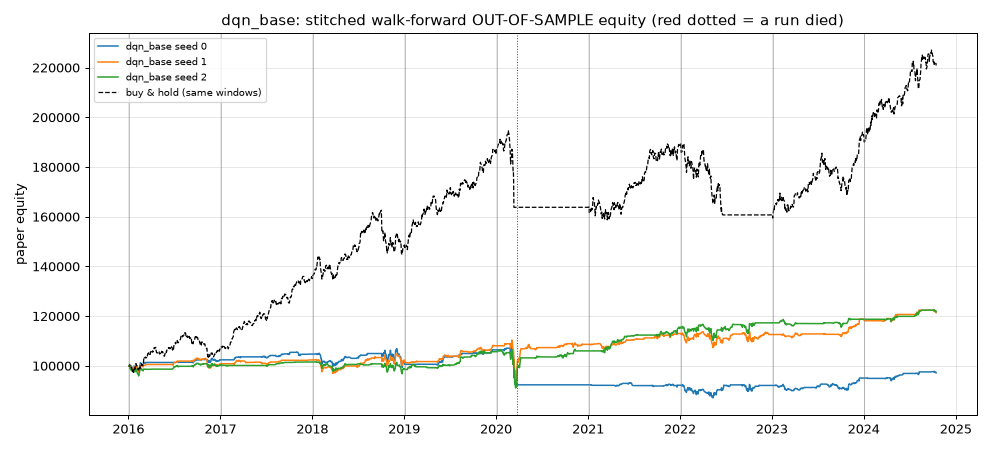

### dqn_longshort
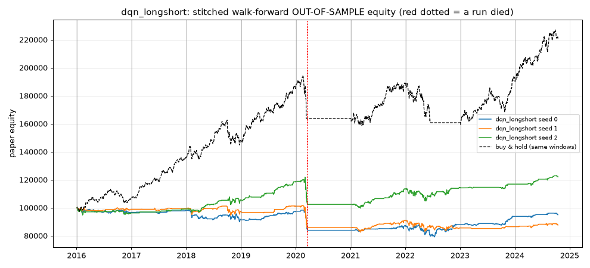

### dqn_strong_dd_penalty
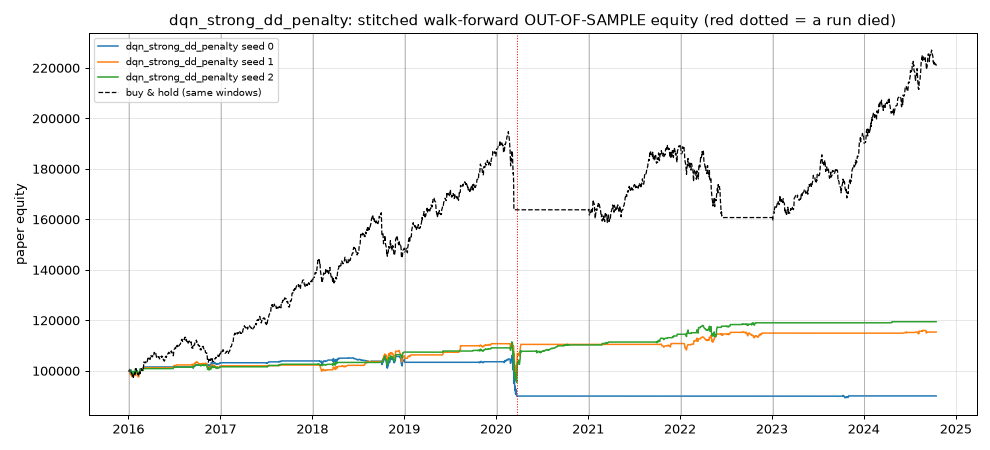

### ppo_base
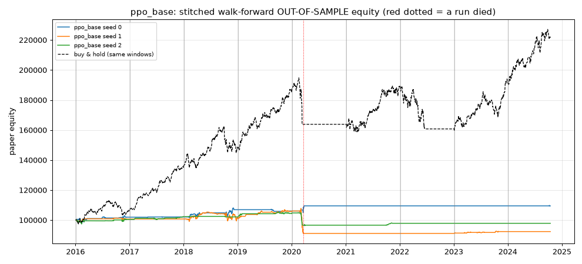

### ppo_cost_aware
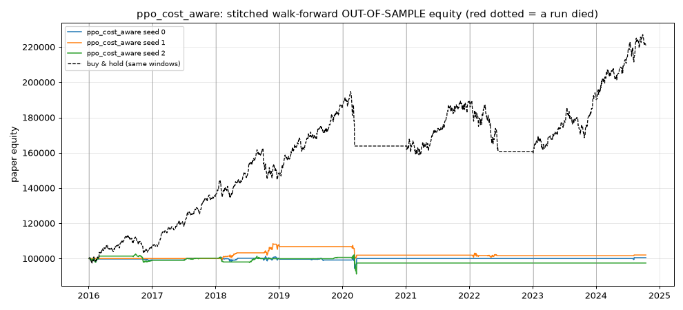

### ppo_half_position
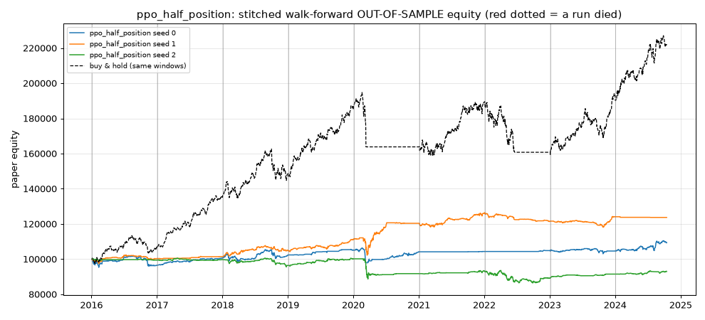

### ppo_longshort
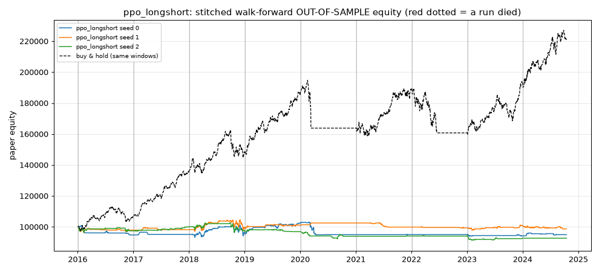

### ppo_pure_return
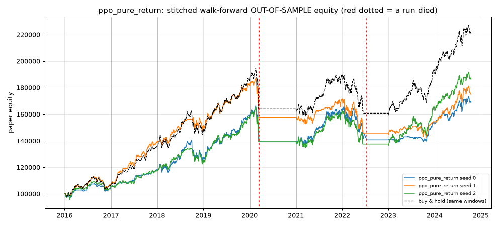

### ppo_risk_penalty
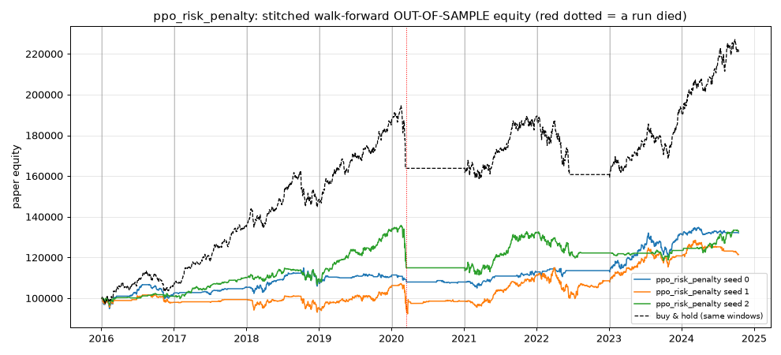

### ppo_strong_dd_penalty
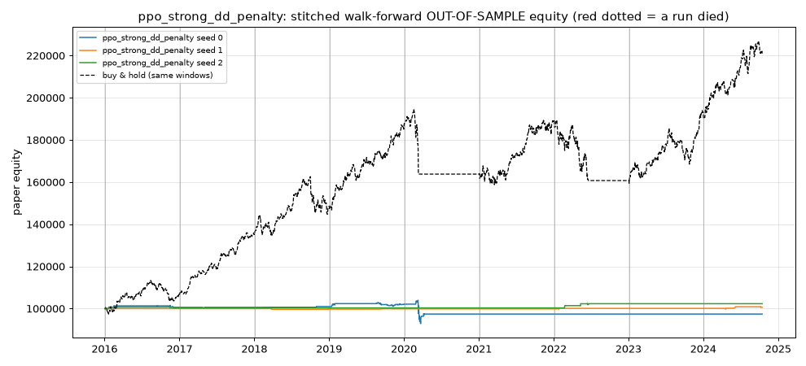

### ppo_trend_features
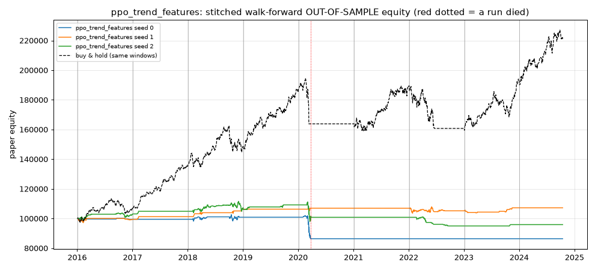

### ppo_window5
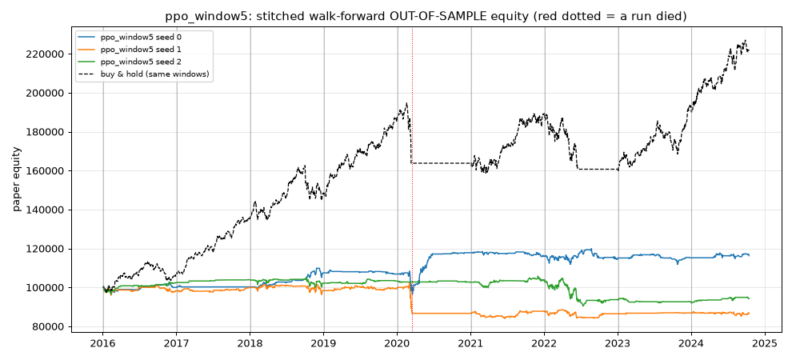

## Caveats

- Validation numbers are optimistic once you pick the best of many variants; the penalized Sharpe tries to correct for that but cannot fully.
- Daily close-to-close fills, fixed proportional costs, no taxes, no borrow fees for shorts, no FX (Indian stocks are in INR, returns are currency-neutral here).
- Yahoo adjusted prices can contain errors; see data-quality table.
- Past performance does not predict future results. Paper trading only.
