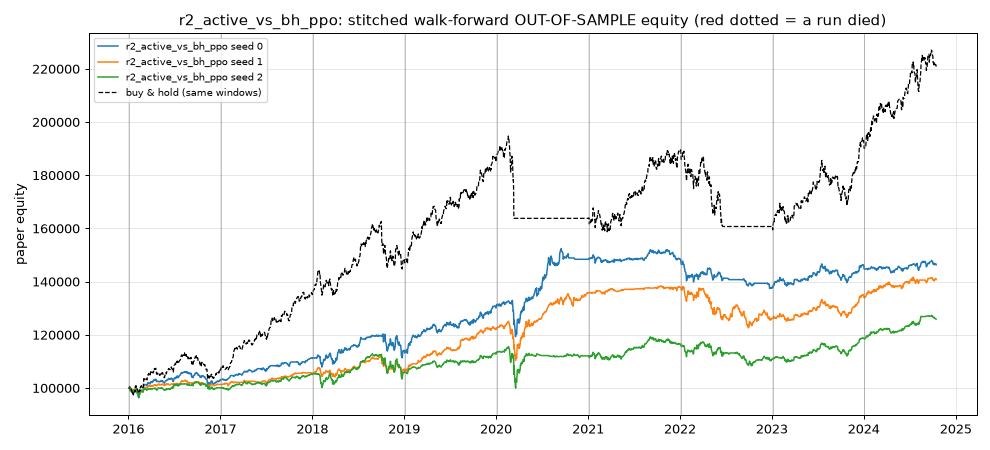
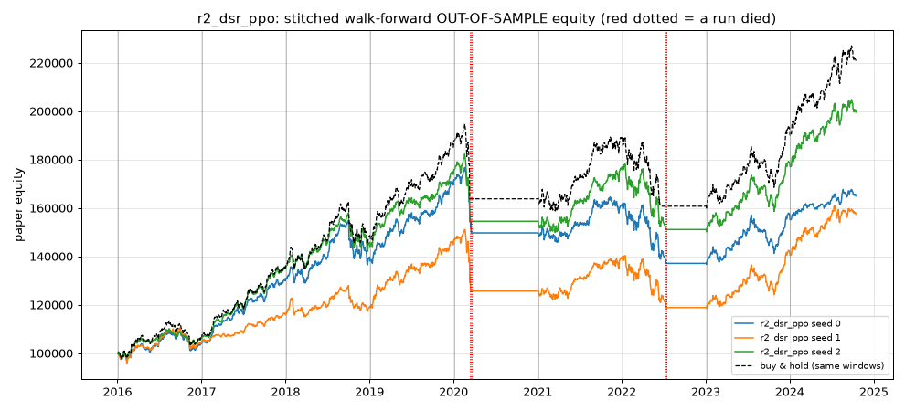
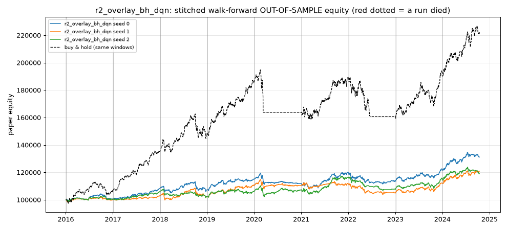
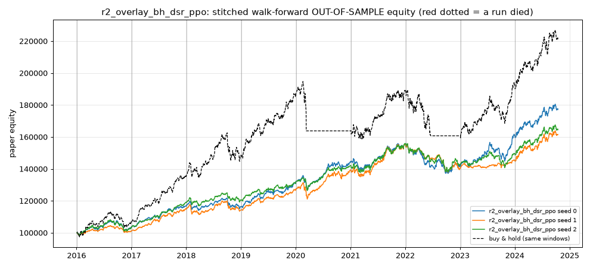
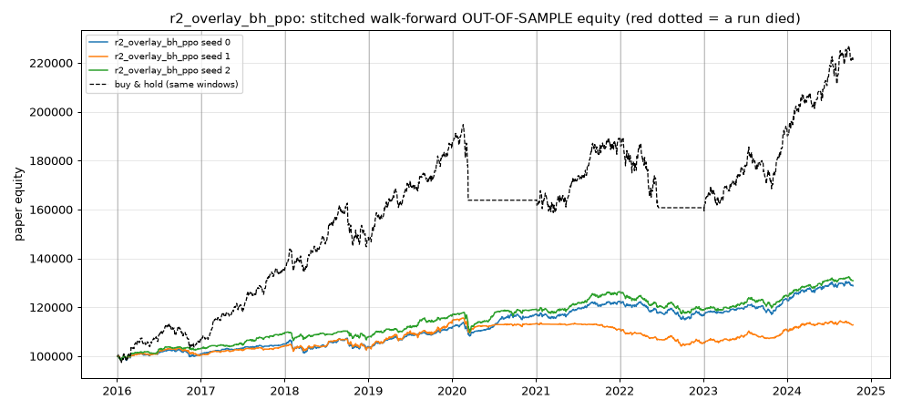
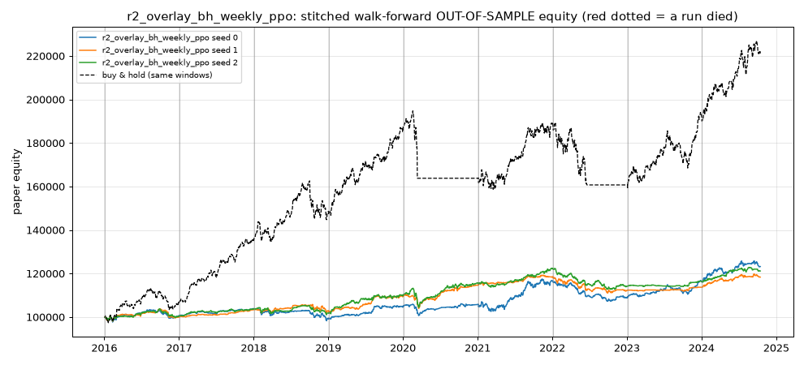
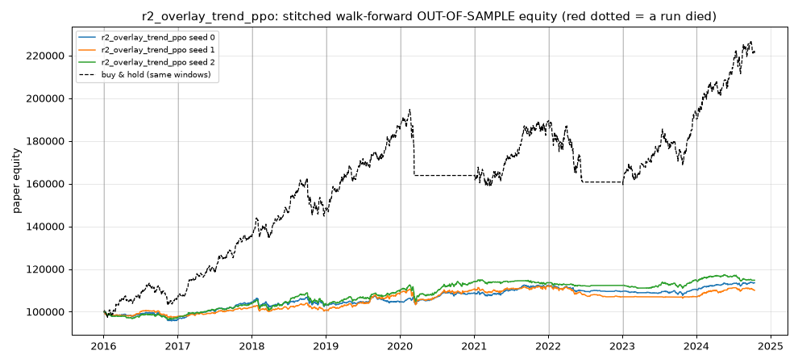
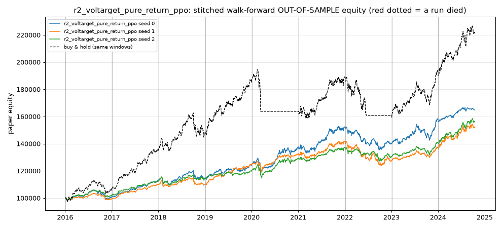

# RESULTS - quant-rl-bot walk-forward research

> Paper-trading research only. Validation (walk-forward out-of-sample) results; the locked test set was **not** used here. final_test.py has not been run yet.

- Generated: 2026-10-18 00:24  
- Data source: `yahoo`  
- Round: 2  
- Variants tried (all rounds, used for Sharpe penalty): **20**  
- Development data ends: 2024-10-15; locked test set: 2024-10-16 -> 2026-10-16  
- Costs: 15 bps per unit traded (commission + slippage)  
- Survival rule: run DEAD if equity falls > 15% below its peak (start 100,000)

## Verdict

**NO STRATEGY PASSED.** No strategy met all of: positive OOS return after costs, penalized Sharpe > 1.0, survival >= 80%, Sharpe above buy-and-hold on the same windows, beating its own rule without RL (overlays), and robustness under 2x costs and other seeds. This is a normal, honest outcome.

Low-risk match (about buy-and-hold's Sharpe with <= 60% of its drawdown; informational, NOT a pass): r2_voltarget_pure_return_ppo

## RL experiments (every variant, including failures)

| experiment | algo | status | runs ok | survived | OOS return (mean seeds) | worst seed | Sharpe | penalized Sharpe | DSR prob | Sortino | max DD (stitched) | turnover/yr | Sharpe - B&H | DD / B&H DD | rule-only Sharpe | low-risk match | verdict |
|---|---|---|---|---|---|---|---|---|---|---|---|---|---|---|---|---|---|
| r2_active_vs_bh_ppo | PPO | ok | 27/27 | 27/27 (100%) | +37.7% | +25.9% | 0.68 | 0.04 | 0.54 | 0.95 | 11.8% | 8.9 | -0.38 | 0.64 | n/a | no | FAIL |
| r2_dsr_ppo | PPO | ok | 27/27 | 21/27 (78%) | +74.0% | +57.5% | 0.83 | 0.19 | 0.71 | 1.15 | 20.7% | 7.4 | -0.23 | 1.12 | n/a | no | FAIL |
| r2_overlay_bh_dqn | DQN | ok | 27/27 | 27/27 (100%) | +23.7% | +19.0% | 0.58 | -0.06 | 0.43 | 0.80 | 9.4% | 11.7 | -0.49 | 0.51 | 1.46 | no | FAIL |
| r2_overlay_bh_dsr_ppo | PPO | ok | 27/27 | 27/27 (100%) | +67.7% | +61.4% | 1.14 | 0.50 | 0.93 | 1.63 | 11.5% | 8.1 | +0.08 | 0.62 | 1.46 | no | FAIL |
| r2_overlay_bh_ppo | PPO | ok | 27/27 | 27/27 (100%) | +24.2% | +12.8% | 0.76 | 0.12 | 0.64 | 1.07 | 7.7% | 6.6 | -0.30 | 0.42 | 1.46 | no | FAIL |
| r2_overlay_bh_weekly_ppo | PPO | ok | 27/27 | 27/27 (100%) | +20.9% | +18.4% | 0.63 | -0.01 | 0.49 | 0.89 | 7.8% | 5.7 | -0.43 | 0.42 | 1.46 | no | FAIL |
| r2_overlay_trend_ppo | PPO | ok | 27/27 | 27/27 (100%) | +12.8% | +10.1% | 0.48 | -0.17 | 0.32 | 0.65 | 6.0% | 7.6 | -0.59 | 0.32 | 1.04 | no | FAIL |
| r2_voltarget_pure_return_ppo | PPO | ok | 27/27 | 27/27 (100%) | +57.6% | +52.0% | 1.09 | 0.45 | 0.90 | 1.55 | 10.7% | 8.3 | +0.03 | 0.58 | 1.46 | yes | FAIL |

Columns: *OOS return* = stitched walk-forward validation return after costs, mean over seeds. *Sharpe* = mean over seeds of the stitched OOS Sharpe. *Penalized Sharpe* = Sharpe minus the expected best-of-N Sharpe under no skill (N = variants tried). *DSR prob* = deflated Sharpe probability. *Survived* = walk-forward runs (fold x seed) that never hit the drawdown kill switch. *Sharpe - B&H* = Sharpe minus buy-and-hold's on the same windows. *DD / B&H DD* = stitched max drawdown relative to buy-and-hold's (below 1 = shallower). *Rule-only Sharpe* = the overlay's rule with the agent removed (multiplier fixed at 1); the agent must beat it. *Low-risk match* = Sharpe within 0.1 of B&H with <= 60% of its drawdown (informational).

## Baselines (same windows, same costs, same survival rule; fixed textbook parameters)

| experiment | algo | status | runs ok | survived | OOS return (mean seeds) | worst seed | Sharpe | penalized Sharpe | DSR prob | Sortino | max DD (stitched) | turnover/yr | Sharpe - B&H | DD / B&H DD | rule-only Sharpe | low-risk match | verdict |
|---|---|---|---|---|---|---|---|---|---|---|---|---|---|---|---|---|---|
| baseline:buy_and_hold | rule | ok | 9/9 | 7/9 (78%) | +120.9% | +120.9% | 1.06 | 0.42 | 0.88 | 1.48 | 18.5% | 1.0 | +0.00 | 1.00 | n/a | no | benchmark |
| baseline:ma_crossover | rule | ok | 9/9 | 8/9 (89%) | +90.6% | +90.6% | 0.96 | 0.32 | 0.82 | 1.32 | 17.1% | 1.8 | -0.10 | 0.93 | n/a | no | benchmark |
| baseline:mean_reversion | rule | ok | 9/9 | 8/9 (89%) | -1.8% | -1.8% | 0.00 | -0.64 | 0.03 | 0.01 | 22.5% | 13.2 | -1.06 | 1.22 | n/a | no | benchmark |
| baseline:momentum | rule | ok | 9/9 | 8/9 (89%) | +51.7% | +51.7% | 0.62 | -0.02 | 0.47 | 0.84 | 22.1% | 6.6 | -0.45 | 1.20 | n/a | no | benchmark |
| baseline:vol_target | rule | ok | 9/9 | 9/9 (100%) | +118.4% | +118.4% | 1.46 | 0.82 | 0.99 | 2.13 | 13.3% | 3.0 | +0.40 | 0.72 | n/a | no | benchmark |
| baseline:trend_vol_target | rule | ok | 9/9 | 9/9 (100%) | +62.4% | +62.4% | 1.04 | 0.40 | 0.88 | 1.48 | 11.5% | 6.8 | -0.02 | 0.62 | n/a | no | benchmark |

## Robustness (top validation candidates)

| candidate | test | status | runs ok | survived | return | Sharpe | pass |
|---|---|---|---|---|---|---|---|
| r2_overlay_bh_dsr_ppo | costs_2x | ok | 27/27 | 27/27 | +50.5% | 0.90 | True |
| r2_overlay_bh_dsr_ppo | other_assets | ok | 27/27 | 25/27 | +33.3% | 0.51 | True |
| r2_overlay_bh_dsr_ppo | other_seeds | not run (failed base criteria) | -/- | -/- | n/a | n/a | - |
| r2_overlay_bh_dsr_ppo | shifted_dates | not run (failed base criteria) | -/- | -/- | n/a | n/a | - |
| r2_voltarget_pure_return_ppo | costs_2x | ok | 27/27 | 27/27 | +41.5% | 0.83 | True |
| r2_voltarget_pure_return_ppo | other_assets | ok | 27/27 | 25/27 | +23.0% | 0.40 | False |
| r2_voltarget_pure_return_ppo | other_seeds | not run (failed base criteria) | -/- | -/- | n/a | n/a | - |
| r2_voltarget_pure_return_ppo | shifted_dates | not run (failed base criteria) | -/- | -/- | n/a | n/a | - |
| r2_dsr_ppo | costs_2x | ok | 27/27 | 21/27 | +57.8% | 0.69 | False |
| r2_dsr_ppo | other_assets | ok | 27/27 | 21/27 | +33.4% | 0.37 | False |
| r2_dsr_ppo | other_seeds | not run (failed base criteria) | -/- | -/- | n/a | n/a | - |
| r2_dsr_ppo | shifted_dates | not run (failed base criteria) | -/- | -/- | n/a | n/a | - |

## Why each RL experiment failed or passed

- **r2_active_vs_bh_ppo**: penalized Sharpe 0.04 (raw 0.68 - haircut 0.64) not > 1.0; Sharpe 0.68 not above buy-and-hold 1.06 (same windows); robustness 'costs_2x' not run; robustness 'other_seeds' not run
- **r2_dsr_ppo**: penalized Sharpe 0.19 (raw 0.83 - haircut 0.64) not > 1.0; survival 21/27 = 78% < 80%; Sharpe 0.83 not above buy-and-hold 1.06 (same windows); robustness 'costs_2x' failed: survival 78%; robustness 'other_seeds' not run (not run (failed base criteria))
- **r2_overlay_bh_dqn**: penalized Sharpe -0.06 (raw 0.58 - haircut 0.64) not > 1.0; Sharpe 0.58 not above buy-and-hold 1.06 (same windows); Sharpe 0.58 not above its own rule without RL 1.46 - the RL part added nothing; robustness 'costs_2x' not run; robustness 'other_seeds' not run
- **r2_overlay_bh_dsr_ppo**: penalized Sharpe 0.50 (raw 1.14 - haircut 0.64) not > 1.0; Sharpe 1.14 not above its own rule without RL 1.46 - the RL part added nothing; robustness 'other_seeds' not run (not run (failed base criteria))
- **r2_overlay_bh_ppo**: penalized Sharpe 0.12 (raw 0.76 - haircut 0.64) not > 1.0; Sharpe 0.76 not above buy-and-hold 1.06 (same windows); Sharpe 0.76 not above its own rule without RL 1.46 - the RL part added nothing; robustness 'costs_2x' not run; robustness 'other_seeds' not run
- **r2_overlay_bh_weekly_ppo**: penalized Sharpe -0.01 (raw 0.63 - haircut 0.64) not > 1.0; Sharpe 0.63 not above buy-and-hold 1.06 (same windows); Sharpe 0.63 not above its own rule without RL 1.46 - the RL part added nothing; robustness 'costs_2x' not run; robustness 'other_seeds' not run
- **r2_overlay_trend_ppo**: penalized Sharpe -0.17 (raw 0.48 - haircut 0.64) not > 1.0; Sharpe 0.48 not above buy-and-hold 1.06 (same windows); Sharpe 0.48 not above its own rule without RL 1.04 - the RL part added nothing; robustness 'costs_2x' not run; robustness 'other_seeds' not run
- **r2_voltarget_pure_return_ppo**: penalized Sharpe 0.45 (raw 1.09 - haircut 0.64) not > 1.0; Sharpe 1.09 not above its own rule without RL 1.46 - the RL part added nothing; robustness 'other_seeds' not run (not run (failed base criteria))

## Walk-forward folds

| fold | train | validation |
|---|---|---|
| 0 | 2012-01-04 -> 2015-12-28 | 2016-01-04 -> 2017-01-03 |
| 1 | 2012-01-04 -> 2016-12-28 | 2017-01-04 -> 2018-01-03 |
| 2 | 2012-01-04 -> 2017-12-28 | 2018-01-04 -> 2019-01-03 |
| 3 | 2012-01-04 -> 2018-12-28 | 2019-01-04 -> 2020-01-03 |
| 4 | 2012-01-04 -> 2019-12-30 | 2020-01-04 -> 2021-01-03 |
| 5 | 2012-01-04 -> 2020-12-28 | 2021-01-04 -> 2022-01-03 |
| 6 | 2012-01-04 -> 2021-12-28 | 2022-01-04 -> 2023-01-03 |
| 7 | 2012-01-04 -> 2022-12-28 | 2023-01-04 -> 2024-01-03 |
| 8 | 2012-01-04 -> 2023-12-28 | 2024-01-04 -> 2024-10-15 |

## Data quality

| ticker | rows | start | end | years | jumps > 25% (check splits) |
|---|---|---|---|---|---|
| SPY | 4223 | 2010-01-04 | 2026-10-16 | 16.8 | - |
| QQQ | 4223 | 2010-01-04 | 2026-10-16 | 16.8 | - |
| GLD | 4223 | 2010-01-04 | 2026-10-16 | 16.8 | - |
| TLT | 4223 | 2010-01-04 | 2026-10-16 | 16.8 | - |
| RELIANCE.NS | 4145 | 2010-01-04 | 2026-10-16 | 16.8 | - |
| TCS.NS | 4145 | 2010-01-04 | 2026-10-16 | 16.8 | - |

## Equity curves (out-of-sample, stitched)

### r2_active_vs_bh_ppo

### r2_dsr_ppo

### r2_overlay_bh_dqn

### r2_overlay_bh_dsr_ppo

### r2_overlay_bh_ppo

### r2_overlay_bh_weekly_ppo

### r2_overlay_trend_ppo

### r2_voltarget_pure_return_ppo

## Caveats

- Validation numbers are optimistic once you pick the best of many variants; the penalized Sharpe tries to correct for that but cannot fully.
- Daily close-to-close fills, fixed proportional costs, no taxes, no borrow fees for shorts, no FX (Indian stocks are in INR, returns are currency-neutral here).
- Yahoo adjusted prices can contain errors; see data-quality table.
- Past performance does not predict future results. Paper trading only.
